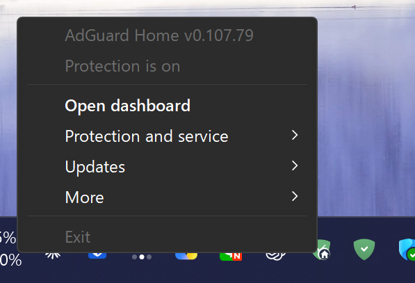
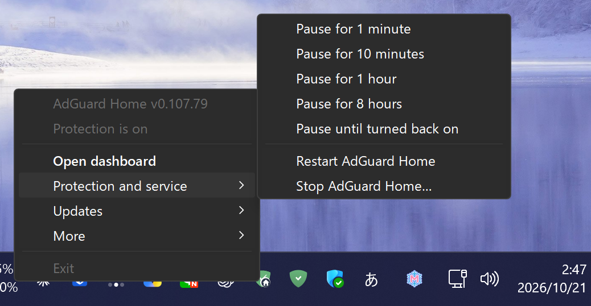
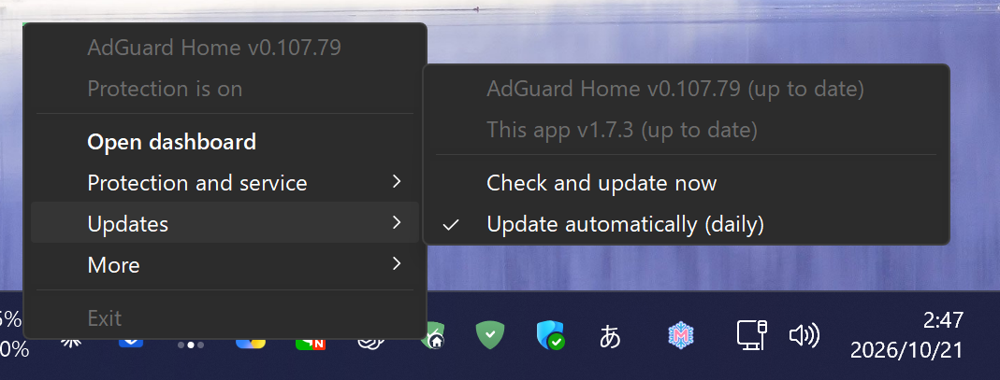
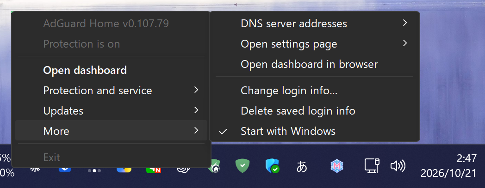
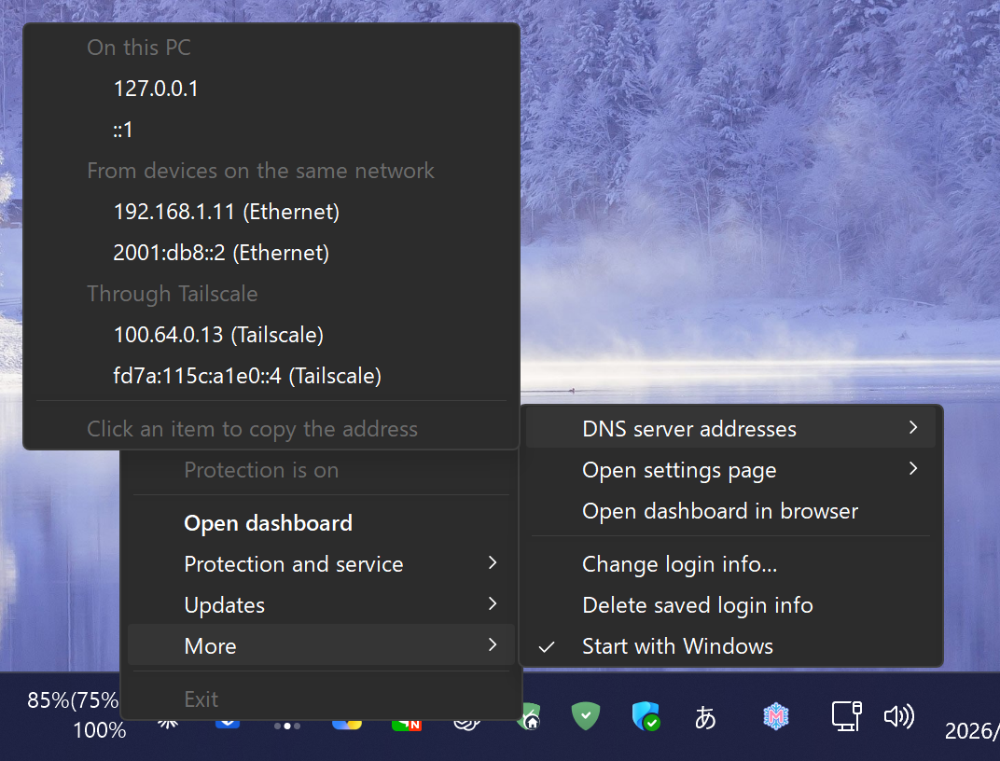
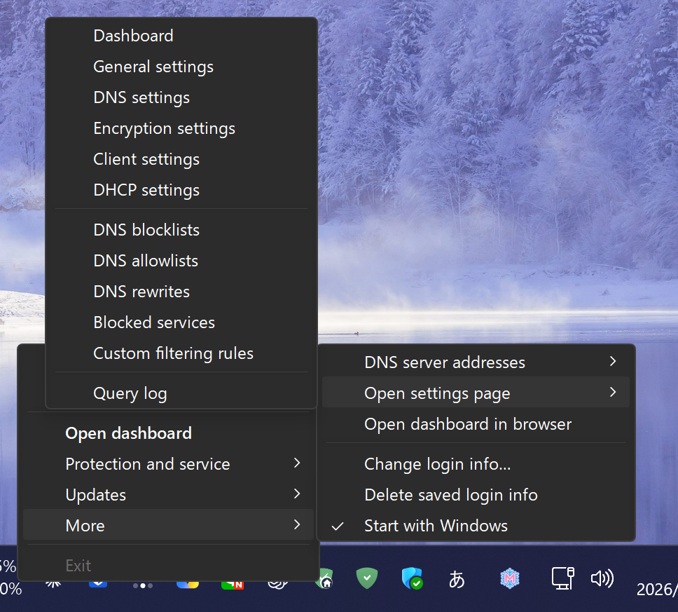
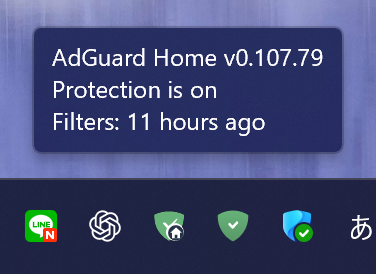
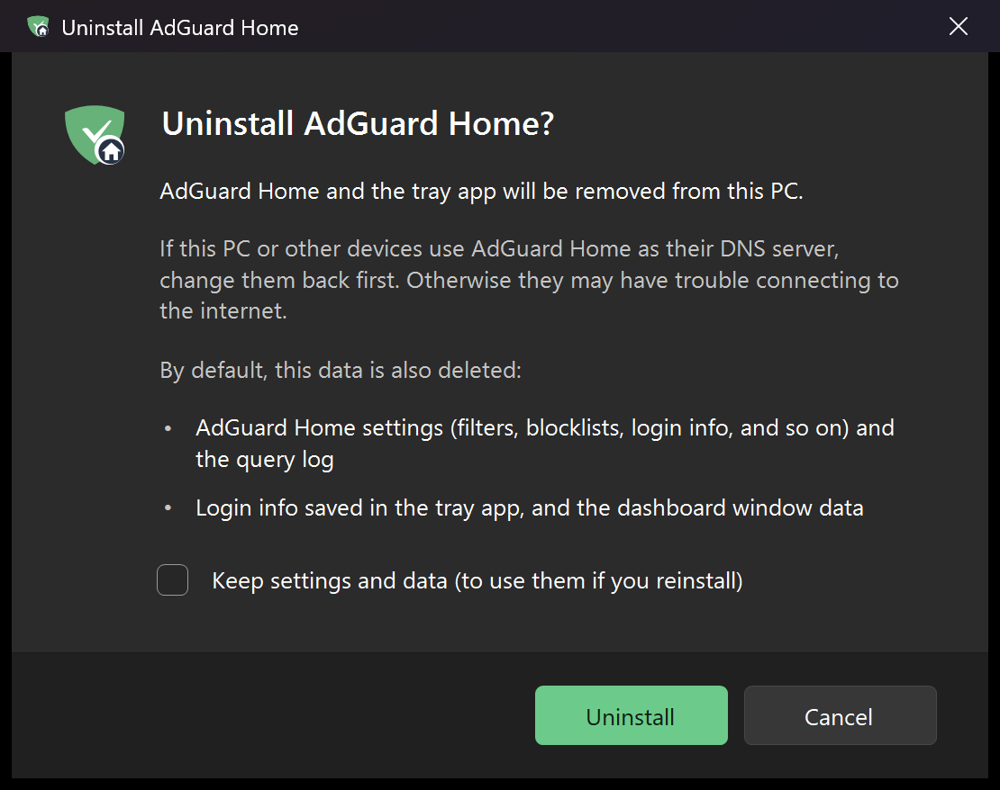
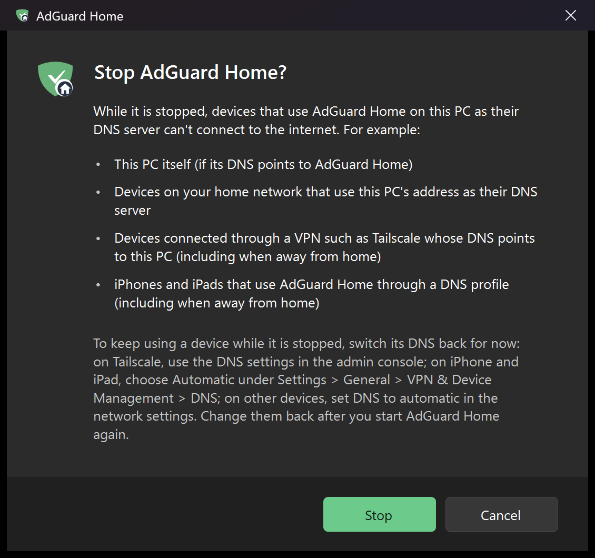
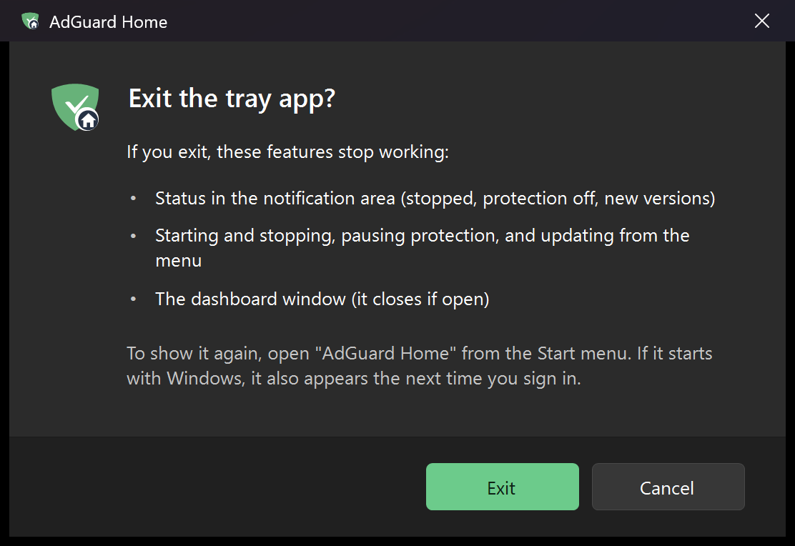

# AdGuard Home for Windows

[日本語](README.md) | English

This setup kit runs the official [AdGuard Home](https://github.com/AdguardTeam/AdGuardHome) as a Windows service. You control it from an icon in the notification area (system tray). You can check its status, pause protection, update it, and open the dashboard. It starts with your PC. You don't need to keep a console window open.

## Quick install

**Use one PowerShell command**

Right-click the Start button and choose **Terminal** to open PowerShell. Paste this command and press Enter. You don't need to run PowerShell as an administrator. When Windows asks "Do you want to allow this app to make changes to your device?", choose **Yes**. The command runs [get.ps1](get.ps1), which downloads the latest release, checks its SHA-256, installs it while showing its progress in the console, and sets it to start when you sign in. When it finishes, a window appears. Leave **Start AdGuard Home and open the initial setup** checked (the default) and click **Finish** to open the initial setup page.

```powershell
irm https://raw.githubusercontent.com/hinatamaxxx/adguard-home-windows/main/get.ps1 | iex
```

**Ask an AI agent**

Give this request to an AI coding agent such as Claude Code or Codex. The agent follows [AGENTS.md](AGENTS.md). It tells you which steps you must do yourself, such as approving the administrator prompt (UAC) and choosing a password.

```
Set up https://github.com/hinatamaxxx/adguard-home-windows
```

If you also want either of these, include it in your request. The agent will guide you through that setup too:

- Use it from other devices at home, such as phones, tablets, and game consoles
- Use it on an iPhone or iPad away from home (uses Tailscale)

**After installing**

Double-click the AdGuard Home icon in the notification area. Complete the AdGuard Home initial setup and choose an administrator user name and password. To use it from other devices at home or away from home, see sections 2 and 3 of [AGENTS.md](AGENTS.md).

> This repository does not include AdGuard Home itself. Setup downloads it from the official AdGuard servers. It checks the AdGuard signature before installing it. This project is not affiliated with AdGuard.

## Screenshots

**Notification area menu** (the standard Windows menu, with dark mode support)



| Pause protection and control the service | Updates |
|---|---|
|  |  |

| More | DNS server addresses |
|---|---|
|  |  |

| Open settings page |
|---|
|  |

Note: The address screenshot uses a special build that shows example addresses. The released app does not include this feature.

| Tooltip | Icons for each state (the shield changes to the AdGuard Home logo after AdGuard Home is installed) |
|---|---|
|  |  |

**Dashboard window** (a separate window that follows the Windows light/dark setting and signs in with your saved login info; the dashboard is AdGuard Home's own web interface)


| Uninstall | Stop confirmation |
|---|---|
|  |  |

| Exit confirmation |
|---|
|  |

## Features

- Runs AdGuard Home as a Windows service. It starts with your PC, restarts if it stops unexpectedly, and shows no console window
- Adds a notification area icon and menu. You can check status, open the dashboard, pause protection (1 minute to 8 hours, or until you turn it back on), start/stop/restart the service, and manage updates
- Opens the dashboard in its own window (WebView2), without browser toolbars, and signs in automatically
- Updates AdGuard Home and this app automatically every day (no UAC prompt; on by default)
- Lets you turn starting with Windows on or off in Windows **Settings > Apps > Startup**
- Uses Japanese or English to match your Windows display language
- Writes to the registry only for the AdGuard Home service and the **Installed apps** entry. Uninstalling deletes settings and data by default, but you can choose to keep them
- Works from an iPhone or iPad away from home through Tailscale Funnel and a DNS configuration profile (see "iOS / iPadOS" below). Devices with the Tailscale app only need the Tailscale DNS settings

## Sleep

AdGuard Home runs on this PC. **While the PC is asleep or off, devices that use this PC for DNS cannot connect to the internet. This includes devices connected through Tailscale and iPhones or iPads with the DNS profile.** If other devices use it, set Windows to keep the PC awake.

- In **Settings > System > Power & battery > Screen, sleep, & hibernate timeouts**, set "When plugged in, put my device to sleep after" to **Never**. On a laptop, also turn off sleep on battery if needed
- The screen can still turn off

## Requirements

- Windows 10 or 11 (x64 or ARM64) and .NET Framework 4.8 (included with Windows)
- Microsoft Edge WebView2 Runtime (included with Windows 11; without it, the dashboard opens in your default browser)
- [Tailscale](https://tailscale.com/) to use it away from home

On ARM64 Windows, setup installs the ARM64 version of AdGuard Home. This has not been tested on actual ARM64 hardware.

## Install and update

Install it as described in "Quick install" above. After that, it updates itself automatically (see "How updates work"). You can turn off starting with Windows under **More** in the tray menu or in Windows **Settings > Apps > Startup**.

To build from source, run `build.ps1`, then run `install.ps1` in PowerShell as an administrator.

## Layout

| Location | Contents |
|---|---|
| `C:\Program Files\AdGuardHome\` | AdGuard Home, its settings, and its data. Only administrators can access this folder because of AdGuard Home's own permission check |
| `C:\Program Files\AdGuardHome Tray\` | The tray app `AdGuardHomeTray.exe`, the WebView2 components (`Microsoft.Web.WebView2.*.dll`, `WebView2Loader.dll`), `manage.ps1`, and `uninstall.ps1` |
| `C:\ProgramData\AdGuardHome\settings.json` | Settings shared by the tray app and `manage.ps1`: install locations, automatic updates on/off, versions, dashboard URL, and update results. SYSTEM and administrators can write to it. Users can only read it |
| `C:\ProgramData\AdGuardHome\logs\` | `AdGuardHome.log` (AdGuard Home) and `manage.log` (operations and updates) |
| `%APPDATA%\AdGuardHomeTray\credentials.dat` | Dashboard login info, encrypted for each user with Windows DPAPI |
| Service `AdGuardHome` | Starts with the PC and shows no console window. Restarts if it stops unexpectedly |
| Task `AdGuardHome AutoUpdate` | Runs as SYSTEM at startup, at sign-in, and every day around 4:30. Records version info. Updates AdGuard Home and the tray app if automatic updates are on |
| Task `AdGuardHome UpdateNow` | Runs when you choose **Check and update now** in the tray menu. It has no triggers. Signed-in users can run it without a UAC prompt |
| `Startup\AdGuard Home.lnk` | Starts the tray app when you sign in. It is in each user's Startup folder. Turn it on or off in Windows **Settings > Apps > Startup** or in the tray menu |

## Tray icon

- Green shield with a check mark: running / Orange: a new version is available (only when automatic updates are off) / Gray with an X: stopped / Red with an X: the service is not installed
- Double-click the icon to open the dashboard in its own window. You can also choose **AdGuard Home** in the Start menu. If the tray app isn't running, this starts it first
- In the dashboard window, press F5 or Ctrl+R to reload. Press Alt+Left Arrow to go back. Links outside the dashboard open in your default browser
- The context menu shows the status (version and protection state), **Open dashboard**, **Protection and service**, **Updates**, **More**, and **Exit**. Under **More**, you can find DNS server addresses, settings pages, opening in a browser, login info, and starting with Windows
- **Exit** is always the last menu item. You can use it only when AdGuard Home is stopped. While AdGuard Home runs, **Exit** is grayed out. Hover over it to see why. Clicking it opens a confirmation that explains what stops working and how to show the app again. **Cancel** is selected first
- Use **Set login info…** to save the dashboard user name and password. They are encrypted with Windows DPAPI and saved in `%APPDATA%\AdGuardHomeTray\credentials.dat`. You can then see the protection status and pause protection for 1 minute, 10 minutes, 1 hour, 8 hours, or until you turn it back on. The icon is gray while protection is off
- **DNS server addresses** shows addresses to enter in a device's DNS server field. They are grouped into this PC, your local network, and Tailscale. Click an address to copy it. No login is needed. A warning appears if the firewall blocks incoming connections
- **Open settings page** takes you straight to pages such as DNS settings, blocklists, and the query log
- Starting, stopping, and restarting the service require administrator permission (UAC). So does turning automatic updates on or off. Updating does not require it (see "How updates work")
- The "AdGuard Home has stopped" notification appears only after an unexpected stop. It does not appear when an update or restart stops the service, while `manage.ps1` keeps `C:\ProgramData\AdGuardHome\maintenance.json` in place. It also does not appear when you stop the service from the tray. The app waits until the service has been stopped for 10 seconds, so brief stops do not cause alerts
- If an update or restart fails partway, `manage.ps1` starts the service again before it finishes. This keeps DNS from staying down
- If you sign in by typing in the dashboard window, the app asks whether to save that login info in the tray app too. If it differs from the saved info, the app asks whether to update it

## How updates work

The **Updates** menu shows separate versions for AdGuard Home and this app. Submenus open upward from the menu item.

```
Updates ▸
  AdGuard Home v0.107.79 (up to date)
  This app v1.8.7 (up to date)
  ─────────────
  Check and update now
  ✓ Update automatically (daily)
```

- **Update automatically (on by default)**: a task runs as SYSTEM every day, at startup, and at sign-in. It updates AdGuard Home with the official updater. It updates this app with the latest version from GitHub Releases. There is no UAC prompt. Successful updates do not show a notification; check the versions in the menu. You get a notification only after two failures in a row
- **Check and update now**: runs the same update process right away, without a UAC prompt, and tells you the result
- Only when automatic updates are off, the app tells you about new versions and turns the icon orange. Click the notification to update
- Before updating this app, the updater checks `adguard-home-windows.zip` against `adguard-home-windows.zip.sha256` from the same release in this repository. It then replaces the files. The tray app keeps running. When it detects the new version, it restarts itself after you close any open window, such as the dashboard
- The log is in `C:\ProgramData\AdGuardHome\logs\manage.log`

## Icons

The AdGuard logo is a trademark of AdGuard, so it is not included in what this project distributes (this repository and the release ZIP). The icon built into the exe is the app's own shield. After installation, the logo is taken from the dashboard of your installed AdGuard Home and used for:

- The notification area icon (drawn by the tray app while it runs)
- The **AdGuard Home** icon in the Start menu and in **Installed apps** (`manage.ps1` has the tray app draw `C:\ProgramData\AdGuardHome\AdGuardHome-<mark>.ico` and points the shortcut and the entry to it; it is redrawn when the logo is taken and after each update)

## Display language

The app uses Japanese if your Windows display language is Japanese. Otherwise, it uses English. To choose a language for testing, set the environment variable `ADGUARD_TRAY_LANG` to `ja` or `en` before starting the tray app.

## Files

- `get.ps1`: installs with one command. It is saved as UTF-8 without a BOM because it is loaded with `irm … | iex`. It downloads the latest release ZIP, checks its SHA-256, installs it while showing its progress, and then shows a completion window
- `src/AdGuardHomeTray.cs`: the tray app, built with the .NET Framework 4.x `csc.exe`
- `src/L10n.cs`: display language (Japanese and English)
- `src/DashboardForm.cs`: the separate dashboard window (WebView2) / `src/Theme.cs`: light and dark themes
- `src/DialogKit.cs`: shared dialog parts in the Windows 11 style / `src/StepsDialogs.cs`, `src/ExitDialog.cs`, `src/StopDialog.cs`: the install/uninstall progress, exit, and stop windows
- `src/TrayContext.MenuHover.cs`: descriptions that appear when you hover over menu items
- `src/TrayContext.Update.cs`: shows versions, runs updates now, reports automatic update failures, and restarts the app after an update
- `src/TrayContext.SubmenuUp.cs`: opens submenus upward from the parent item
- `lib/webview2/`: WebView2 SDK (Microsoft.Web.WebView2 1.0.4258.31 from nuget.org; Microsoft signature verified)
- `build.ps1`: builds `build\AdGuardHomeTray.exe`
- `scripts/manage.ps1`: controls the service and runs updates as administrator or SYSTEM
- `scripts/configure-adguard.ps1`: changes AdGuard Home settings. `-EnableFunnelDoH` accepts DoH through Funnel. `-Faster` makes it faster. The script checks the result before applying it and makes a backup
- `scripts/new-ios-dns-profile.ps1` / `scripts/set-client-name.ps1`: creates a DNS profile for iOS / registers a device name
- `AGENTS.md` (loaded from `CLAUDE.md`): installation steps for AI agents
- `install.ps1`: the install script. It runs as administrator and is called through UAC from `get.ps1`
- `uninstall.ps1`: removes the app. You can run it from **AdGuard Home for Windows** in Windows **Settings > Apps > Installed apps**. It asks for administrator permission automatically. By default, it also deletes all settings and data. To keep them, check "Keep settings and data" in the confirmation. Use `-Quiet` to skip the confirmation and `-KeepSettings` to keep settings and data

## Registry keys and files that change

AdGuard Home runs as a Windows service, so everything is installed for the whole PC in `C:\Program Files`. Files store settings, login info, and the choice to start with Windows. The app writes only two kinds of registry entries: the service registration and the **Installed apps** entry.

### Registry

| Location | What is created | On uninstall |
|---|---|---|
| `HKLM\SYSTEM\CurrentControlSet\Services\AdGuardHome` | Service registration, created by `AdGuardHome.exe -s install` | Deleted |
| `HKLM\SOFTWARE\Microsoft\Windows\CurrentVersion\Uninstall\AdGuardHomeTray` | The **Installed apps** entry: name, version, and how to uninstall | Deleted |

When you turn startup on or off in Windows **Startup** settings, Windows writes the value `AdGuard Home.lnk` under `HKCU\Software\Microsoft\Windows\CurrentVersion\Explorer\StartupApproved\StartupFolder`. The tray app only reads this value. It never writes it. Uninstalling leaves it in place because Windows manages it.

### Files, folders, and other items

| Location | Contents | On uninstall |
|---|---|---|
| `C:\Program Files\AdGuardHome\AdGuardHome.exe` | AdGuard Home | Deleted |
| `C:\Program Files\AdGuardHome\AdGuardHome.yaml`, `data\` | Settings and data created by AdGuard Home | Deleted unless you choose "Keep settings and data" |
| `C:\Program Files\AdGuardHome Tray\` | The tray app, `manage.ps1`, and `uninstall.ps1` | Deleted |
| `C:\ProgramData\AdGuardHome\` (`settings.json`, `logs\`, the logo files `logo.svg` and `logo.png`, the icon `AdGuardHome-*.ico`, and `maintenance.json` only during updates) | Shared settings, logs, and the logo | Deleted |
| `C:\ProgramData\Microsoft\Windows\Start Menu\Programs\AdGuard Home.lnk` | **AdGuard Home** in the Start menu; opens the dashboard | Deleted |
| Task Scheduler `AdGuardHome AutoUpdate`, `AdGuardHome UpdateNow` | Records info, runs automatic updates, and runs updates now | Deleted |
| `%APPDATA%\Microsoft\Windows\Start Menu\Programs\Startup\AdGuard Home.lnk` | Starts the app with Windows, if turned on | Deleted |
| `%APPDATA%\AdGuardHomeTray\` | The tray app's login info for each user | Deleted unless you choose "Keep settings and data" |
| `%LOCALAPPDATA%\AdGuardHomeTray\` | Dashboard window data: WebView2 cache, sign-in state, and window position in `window.txt` | Deleted unless you choose "Keep settings and data" |

## iOS / iPadOS (without the Tailscale app)

- Tailscale Funnel makes only `https://<PC name>.<tailnet>.ts.net/dns-query/<key>` available on the internet. It forwards requests to AdGuard Home's `/dns-query/<ClientID>`. Tailscale returns 404 for every other path. Those requests never reach AdGuard Home.
- Funnel handles TLS, so AdGuard Home uses `http.doh.insecure_enabled: true`.
- Create the iOS profile with `scripts/new-ios-dns-profile.ps1`. For example, use `-ClientId my-iphone -DisplayName "My iPhone"`. The script also creates the key and adds it to Funnel. The profile contains the key. Don't share it or add it to a repository. `.gitignore` excludes `*.mobileconfig`.
- To name the device, open **Settings > Client settings** in the dashboard. Add a persistent client and use the ClientID as its identifier. You can also use `scripts/set-client-name.ps1 -Id my-iphone -Name "My iPhone"`.
- To change the key, create a new profile with the script. Disable the old key with `tailscale funnel --https=443 --set-path /dns-query/<old key> off`.
- To stop making it available on the internet, run `tailscale funnel --https=443 off`.
- While AdGuard Home is stopped, or the PC is asleep or off, devices that use this PC for DNS cannot look up names or connect to the internet. This includes iPhones and iPads with the profile. DNS profiles have no setting to use another DNS server when there is no response.
- If this happens, open **Settings > General > VPN & Device Management > DNS** on the iPhone or iPad. Choose **Automatic** to use your network's DNS again. Once AdGuard Home is running, choose the AdGuard Home profile on the same screen.
- Choosing **Stop AdGuard Home…** in the tray opens a confirmation. It explains this problem and how to switch back. Exiting the tray app does not stop the AdGuard Home service or affect DNS.

## Tailscale settings

- To use AdGuard Home across your whole tailnet, open **DNS > Global nameservers** in the Tailscale admin console. Add the PC's Tailscale IP (`100.x.y.z`) and turn on **Override local DNS**
- To use Funnel, enable HTTPS certificates in the admin console. The first time you run `tailscale funnel`, follow the link it shows to enable Funnel
- Run Funnel commands from PowerShell. Git Bash rewrites paths such as `/dns-query/...`
- Allow incoming AdGuard Home connections (UDP/TCP 53) in the firewall. Tailscale is treated as a Private network

## Support

This is a personal project, provided as-is. Bug reports, vulnerability reports, questions, and feature requests are not accepted. Use it at your own risk, as stated in the disclaimer in the [LICENSE](LICENSE).

## License and trademarks

- The code in this repository uses the [MIT License](LICENSE), except `lib/webview2/`.
- AdGuard Home is software by AdGuard Software Ltd. under GPL-3.0. This repository does not include it. Setup downloads it from the official servers.
- "AdGuard" is a trademark of AdGuard Software Ltd. This is not an official AdGuard project and is not affiliated with the company.
- The repository does not include the shield logo used in the tray icon. The app gets it from the installed AdGuard Home dashboard. Until then, it shows its own shield icon.
- `lib/webview2/` is Microsoft's WebView2 SDK. Its license is in `LICENSE.txt` in the same folder. Windows updates the WebView2 Runtime that displays the window; this app does not update it. The SDK is updated when a new version of this app is released.

## Notes

- On PCs with WSL or Hyper-V, Windows Internet Connection Sharing (SharedAccess) may be using `0.0.0.0:53`. If so, choosing "All interfaces" for DNS during initial setup fails. Set DNS to listen on `127.0.0.1` if only this PC uses it, or on the PC's LAN IP address.
