# AdGuard Home for Windows

日本語 | [English](README.en.md)

公式の [AdGuard Home](https://github.com/AdguardTeam/AdGuardHome) を Windows のサービスとして動かし、通知領域（タスクトレイ）のアイコンから管理するためのセットアップ一式です。状態の確認、保護の一時停止、更新、管理画面の表示ができます。コンソール画面を開いておく必要はなく、PC の起動時に自動で動きます。

## かんたん導入

**コマンド 1 行で入れる（いちばん簡単）**

PowerShell（スタートボタンを右クリック →「ターミナル」）に次を貼り付けて Enter を押します。管理者として開く必要はありません。最新のリリースをダウンロードして SHA-256 を照合し、セットアップ画面を開きます（中身は [get.ps1](get.ps1)）。「インストール」を押し、「このアプリがデバイスに変更を加えることを許可しますか？」で「はい」を選んでください。

```powershell
irm https://raw.githubusercontent.com/hinatamaxxx/adguard-home-windows/main/get.ps1 | iex
```

**AI に頼む**

Claude Code や Codex などの AI エージェントに、次のように頼みます。AI は [AGENTS.md](AGENTS.md) の手順に沿って進め、管理者権限の確認（UAC）やパスワードの設定など、本人が行う操作を案内します。

```
https://github.com/hinatamaxxx/adguard-home-windows を導入して。
```

次のことも使いたい場合は、一緒に伝えると、その設定まで案内します。

- 家のほかの機器（スマホ・タブレット・ゲーム機など）でも使いたい
- 外出先の iPhone / iPad でも使いたい（Tailscale を使います）

**ZIP から入れる**

1. [Releases](https://github.com/hinatamaxxx/adguard-home-windows/releases/latest) から `AdGuardHomeTray.zip` をダウンロードして展開する（ソースからビルドする場合は、リポジトリの ZIP か `git clone` でも入れられます。初回に自動でビルドします）
2. `Setup.cmd` をダブルクリックし、「インストール」を押して、確認で「はい」を選ぶ

**インストールしたあと**

通知領域の AdGuard Home のアイコンをダブルクリックし、AdGuard Home の初期設定（管理者のユーザー名とパスワードを決める）を行います。家のほかの機器や外出先の機器から使う設定は、[AGENTS.md](AGENTS.md) の 2・3 を参照してください。

> AdGuard Home 本体はこのリポジトリに含みません。セットアップ時に AdGuard 公式の配布元からダウンロードし、AdGuard の署名を確認してから入れます。このプロジェクトは AdGuard 公式のものではありません。

## スクリーンショット

**通知領域のメニュー**（Windows 標準のメニュー。ダークモードに対応）

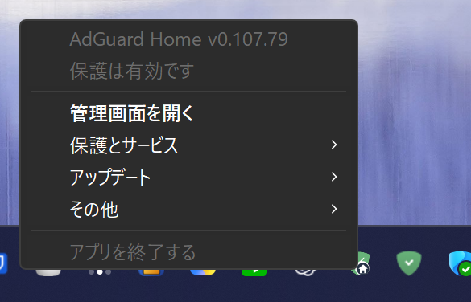

| 保護の一時停止とサービス操作 | アップデート |
|---|---|
| 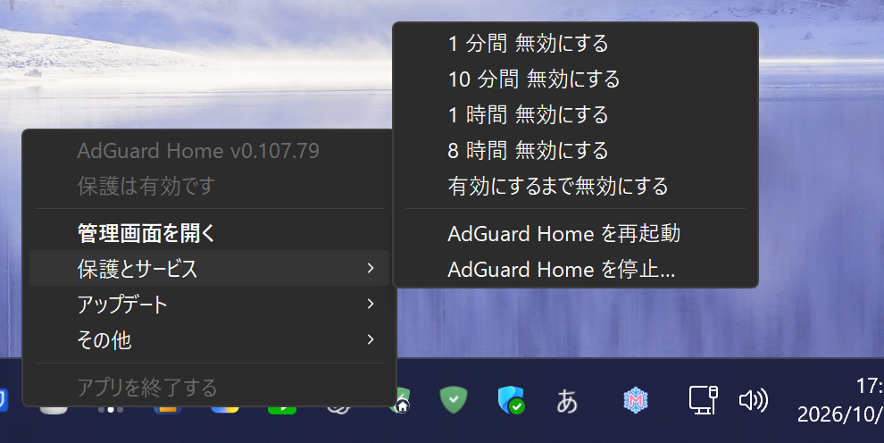 | 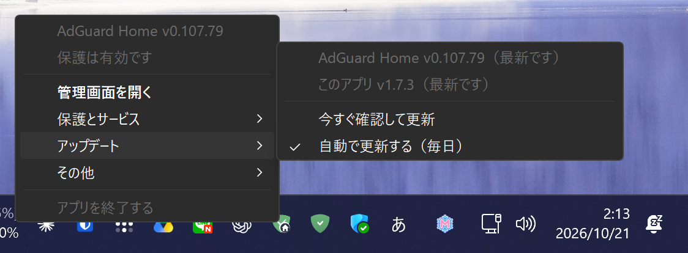 |

| その他 | 接続用アドレス（DNS サーバー） |
|---|---|
| 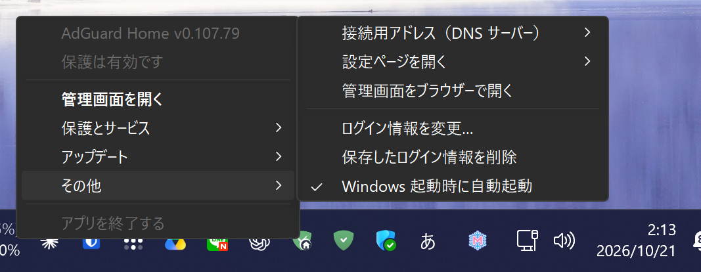 | 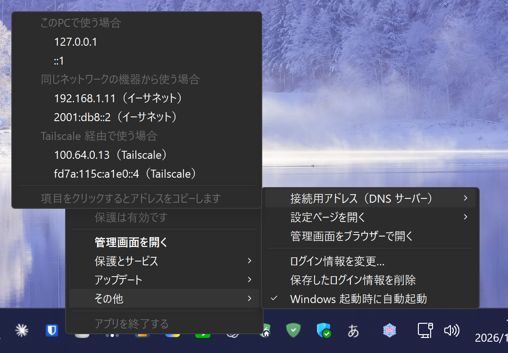 |

| 設定ページを開く |
|---|
| 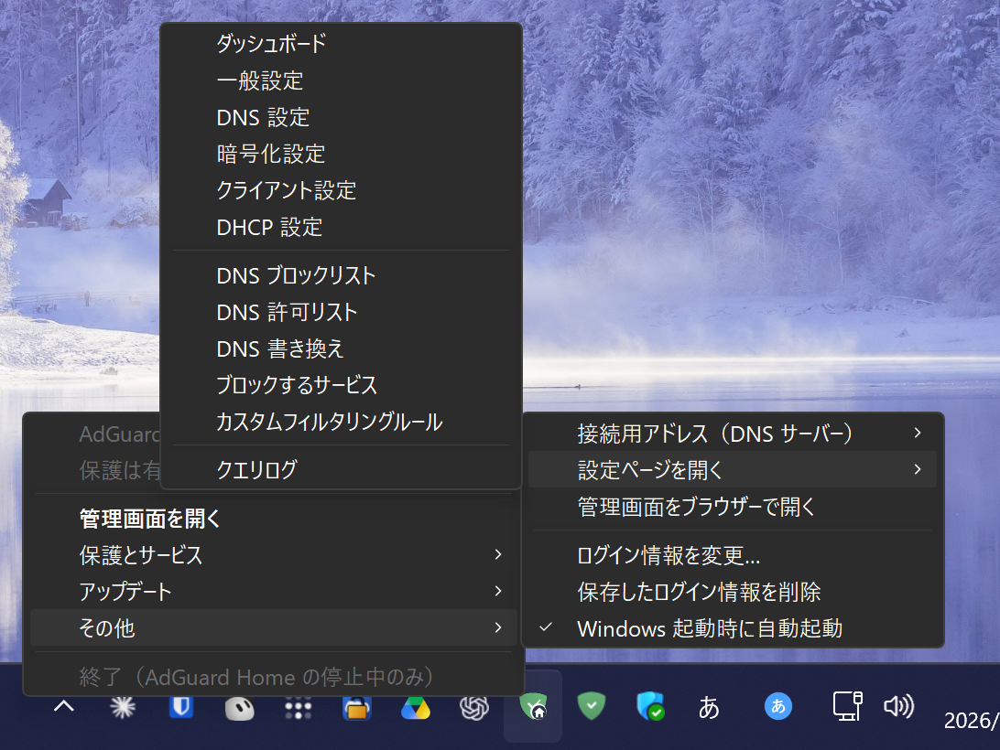 |

※ 接続用アドレスの画像は例示用のアドレスを表示する撮影専用のビルドで撮っています（配布するアプリにはこの機能は入っていません）。

| ツールチップ | 状態別のアイコン（AdGuard Home を入れると、盾の部分が AdGuard Home のロゴになります） |
|---|---|
| 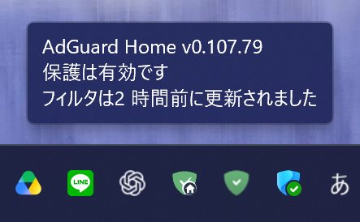 | 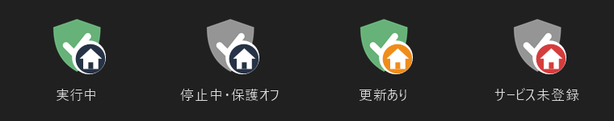 |

**管理画面ウィンドウ**（専用のウィンドウ。Windows のライト/ダークに合わせ、保存したログイン情報で自動ログイン）

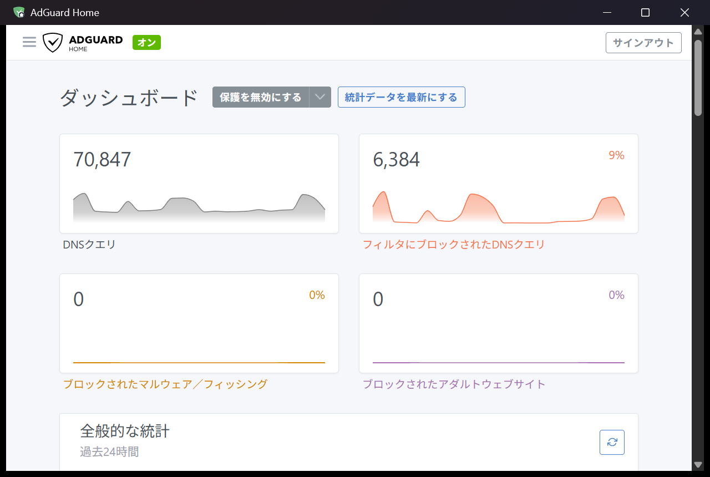

| セットアップ | アンインストール |
|---|---|
| 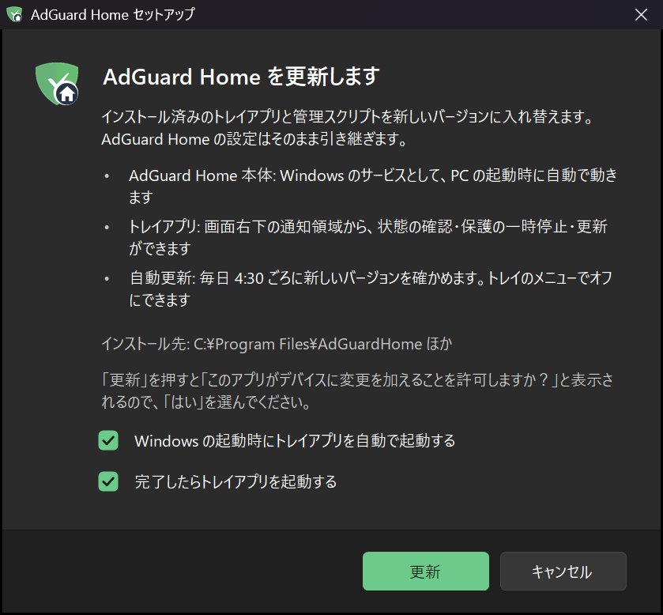 | 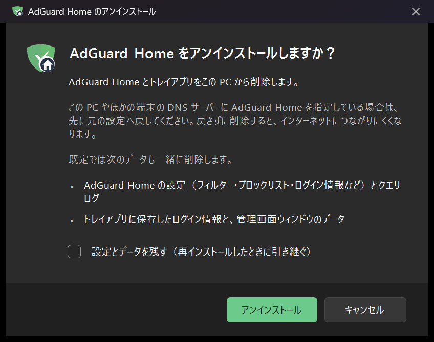 |

| 停止の確認 | 終了の確認 |
|---|---|
| 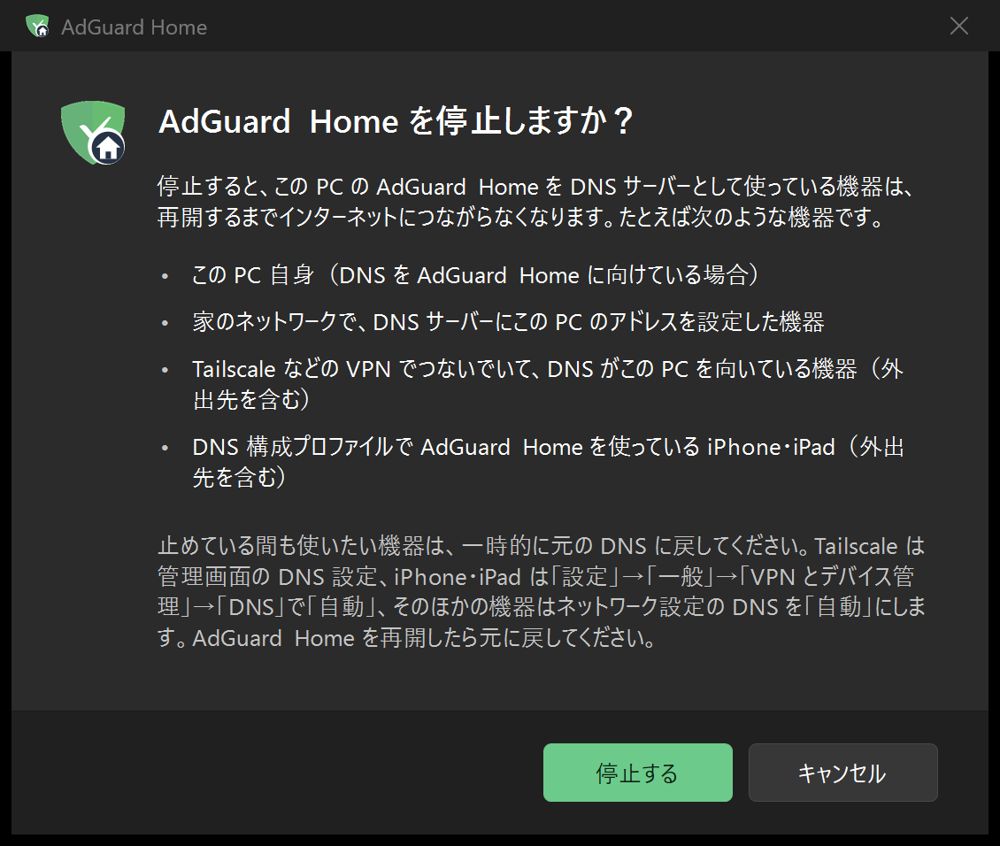 | 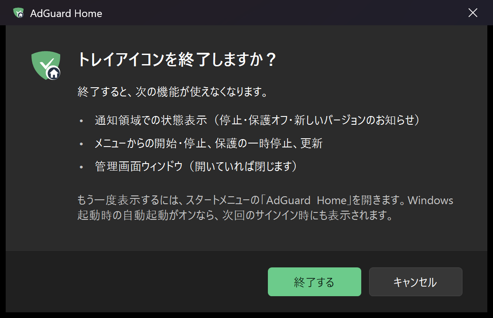 |

## 主な機能

- AdGuard Home を Windows のサービスとして登録（PC の起動時に自動で開始し、異常終了したら自動で再起動。コンソール画面は出ない）
- 通知領域のアイコンとメニュー: 状態の表示、管理画面を開く、保護の一時停止（1 分〜8 時間、または再開するまで）、サービスの開始・停止・再起動、アップデート
- 管理画面を専用のウィンドウ（WebView2）で表示。ブラウザーのような部品は出さず、ログイン画面も自動で通過する
- 自動更新: AdGuard Home 本体とこのアプリの両方を毎日更新（UAC の確認なし。既定でオン）
- ログオン時の自動起動は Windows の「設定 → アプリ → スタートアップ」からもオン/オフできる
- 表示は日本語と英語に対応（Windows の表示言語に合わせる）
- レジストリに書くのは、AdGuard Home のサービス登録と「インストールされているアプリ」への登録だけ。アンインストールでは既定で設定とデータもすべて削除する（「設定とデータを残す」も選べる）
- 外出先の iPhone / iPad からも使える（Tailscale Funnel ＋ DNS 構成プロファイル。下の「iOS / iPadOS」を参照）。Tailscale アプリを入れた機器なら、Tailscale の DNS 設定だけで使える

## PC のスリープについて

AdGuard Home はこの PC で動きます。そのため、**PC がスリープや電源オフの間は、DNS をこの PC に向けた機器（Tailscale でつないだ機器や、DNS プロファイルを入れた iPhone・iPad を含む）がインターネットにつながりません。** ほかの機器でも使う場合は、Windows の設定でスリープしないようにしてください。

- 「設定」→「システム」→「電源とバッテリー」→「画面、スリープ、休止状態のタイムアウト」で、「電源接続時に、次の時間が経過した後にデバイスをスリープ状態にする」を「なし」にする（ノート PC は、必要ならバッテリー駆動時も）
- 画面の電源は切れてもかまいません

## 動作環境

- Windows 10 / 11（x64 または ARM64）、.NET Framework 4.8（Windows に標準で入っています）
- Microsoft Edge WebView2 ランタイム（Windows 11 には標準で入っています。ない場合、管理画面は既定のブラウザーで開きます）
- 外出先から使う場合は [Tailscale](https://tailscale.com/)

ARM64 版の Windows では AdGuard Home の ARM64 版を入れます（この動作は ARM64 の実機では確認していません）。

## インストール・更新

セットアップ画面で入るものを確認し、「インストール」（入れてあれば「更新」）を押します。「このアプリがデバイスに変更を加えることを許可しますか？」で「はい」を選び、完了の画面が出たら終わりです。セットアップ画面では「Windows の起動時にトレイアプリを自動で起動する」（新しく入れるときは既定でオフ、更新のときは今の状態のまま）と、「完了したらトレイアプリを起動する」を選べます。

`install.ps1` を管理者の PowerShell で直接実行しても、同じようにインストールできます（画面なし）。

## 構成

| 場所 | 内容 |
|---|---|
| `C:\Program Files\AdGuardHome\` | AdGuard Home 本体・設定・データ（本体の権限チェックにより管理者専用） |
| `C:\Program Files\AdGuardHome Tray\` | トレイアプリ `AdGuardHomeTray.exe`、WebView2 の部品（`Microsoft.Web.WebView2.*.dll`、`WebView2Loader.dll`）、`manage.ps1`、`uninstall.ps1` |
| `C:\ProgramData\AdGuardHome\settings.json` | トレイと `manage.ps1` の共有設定（インストール先、自動更新のオン/オフ、バージョン、管理画面の URL、更新の結果）。SYSTEM と管理者が書き、ユーザーは読むだけ |
| `C:\ProgramData\AdGuardHome\logs\` | `AdGuardHome.log`（本体）と `manage.log`（操作と更新の記録） |
| `%APPDATA%\AdGuardHomeTray\credentials.dat` | 管理画面のログイン情報（Windows DPAPI でユーザーごとに暗号化） |
| サービス `AdGuardHome` | PC の起動時に自動で開始。コンソール画面は出ない。異常終了したら自動で再起動 |
| タスク `AdGuardHome AutoUpdate` | 起動時・ログオン時・毎日 4:30 ごろに SYSTEM で実行。バージョンの情報を記録し、自動更新がオンなら AdGuard Home とトレイアプリを最新版にする |
| タスク `AdGuardHome UpdateNow` | トレイの「今すぐ確認して更新」で起動する（トリガーなし）。ログオンしている利用者も実行できるので、UAC の確認は出ない |
| `スタートアップ\AdGuard Home.lnk` | ログオン時にトレイアプリを起動する（利用者ごとのスタートアップフォルダー）。オン/オフは、Windows の「設定 → アプリ → スタートアップ」とトレイのメニューのどちらでも切り替えられる |

## トレイアイコン

- 緑の盾とチェック: 実行中 / 橙: 新しいバージョンあり（自動更新をオフにしているときだけ） / 灰と×: 停止中 / 赤と×: サービスが未登録
- ダブルクリック: 管理画面を専用のウィンドウで開く。スタートメニューの「AdGuard Home」からも開ける（トレイが動いていなければ、起動してから開く）
- 専用のウィンドウでは F5 / Ctrl+R で再読み込み、Alt+← で戻る。管理画面以外へのリンクは既定のブラウザーで開く
- 右クリックメニューには状態（バージョンと保護の状態）、管理画面を開く、保護とサービス、アップデート、その他、終了を並べる。接続用アドレス、設定ページ、ブラウザーで開く、ログイン情報、自動起動は「その他」にまとめている
- 「アプリを終了する」は常にメニューの最後にあり、AdGuard Home の停止中だけ押せる（実行中はグレー表示で、マウスを乗せると理由が出る）。押すと、終了で使えなくなる機能と、もう一度表示する方法を書いた確認画面が出る（最初のフォーカスは「キャンセル」）
- 「ログイン情報を設定…」で管理画面のユーザー名とパスワードを保存すると（Windows DPAPI で暗号化して `%APPDATA%\AdGuardHomeTray\credentials.dat` に保存）、保護の状態の表示と一時停止（1 分・10 分・1 時間・8 時間・再開するまで）が使えるようになる。保護がオフの間は、アイコンが灰色になる
- 「接続用アドレス（DNS サーバー）」: 機器の DNS サーバー欄に入れるアドレスを、この PC 用・LAN 用・Tailscale 用に分けて表示する（クリックでコピー、ログイン不要）。ファイアウォールで受信が許可されていないときは警告を出す
- 「設定ページを開く」から、DNS 設定、ブロックリスト、クエリログなどの各ページを直接開ける
- サービスの開始・停止・再起動と、自動更新のオン/オフの切り替えは、UAC で管理者権限を求める（更新そのものは UAC なし。下の「更新のしくみ」）
- 「AdGuard Home が停止しました」の通知は、思いがけず止まったときだけ出す。更新や再起動でサービスを止めている間（`manage.ps1` が `C:\ProgramData\AdGuardHome\maintenance.json` を置いている間）や、トレイの「停止」で止めたときは出さない。一瞬止まってすぐ戻った場合に出ないよう、停止が 10 秒以上続いてから知らせる
- 更新や再起動が途中で失敗しても、`manage.ps1` がサービスを起動し直してから終えるので、DNS が止まったままにならない
- 管理画面のウィンドウで手入力してログインすると、その情報をトレイにも保存するか確認する（保存済みと違う場合は、更新するか確認する）

## 更新のしくみ

「アップデート」メニューには、何のバージョンかを名前で表示します（AdGuard Home 本体と、このアプリ）。子メニューはメニューの「アップデート」より上に向かって開きます。

```
アップデート ▸
  AdGuard Home v0.107.79（最新です）
  このアプリ v1.8.0（最新です）
  ─────────────
  今すぐ確認して更新
  ✓ 自動で更新する（毎日）
```

- **自動で更新する（既定でオン）**: SYSTEM 権限のタスクが毎日（と起動時・ログオン時）、AdGuard Home は公式のアップデーターで、このアプリは GitHub Releases の最新版で更新します。UAC の確認は出ません。成功しても通知はしません（メニューのバージョンの表示で分かります）。続けて 2 回失敗したときだけ通知します
- **今すぐ確認して更新**: 同じ処理をすぐに実行します（UAC なし）。押したときは結果を通知します
- 自動更新をオフにしている場合だけ、新しいバージョンが出たときに通知し、アイコンを橙にします（通知をクリックすると更新します）
- このアプリの更新ではこのリポジトリのリリースにある `AdGuardHomeTray.zip` を、同じリリースの `AdGuardHomeTray.zip.sha256` と照合してから入れ替えます。動いているトレイは止めず、新しいバージョンに入れ替わったことに気づくと自分で再起動します（管理画面などを開いているときは、閉じてから）
- 記録は `C:\ProgramData\AdGuardHome\logs\manage.log` にあります

## アイコン

AdGuard のロゴは AdGuard 社の商標なので、配布物（このリポジトリとリリースの ZIP）には入れていません。そのため exe に入っているアイコンは、独自に描いた盾です。インストールしたあとは、手元の AdGuard Home の管理画面からロゴを取得し、次のアイコンに使います。

- 通知領域のアイコン（トレイアプリが実行中に描く）
- スタートメニューの「AdGuard Home」と、「インストールされているアプリ」の一覧のアイコン（`manage.ps1` がトレイアプリに `C:\ProgramData\AdGuardHome\AdGuardHome-<印>.ico` を描かせ、ショートカットと登録をそれに向ける。ロゴを取得したときと、更新のたびに作り直す）

## 表示の言語

Windows の表示言語が日本語なら日本語、それ以外なら英語で表示します。確認のために言語を指定したいときは、環境変数 `ADGUARD_TRAY_LANG` に `ja` か `en` を設定してからトレイアプリを起動します。

## ファイル

- `get.ps1`: コマンド 1 行での導入用（`irm … | iex` で読み込むため、BOM なしの UTF-8）。最新のリリースの ZIP を SHA-256 で照合し、セットアップ画面を開く
- `src/AdGuardHomeTray.cs`: トレイアプリ（.NET Framework 4.x の `csc.exe` でビルド）
- `src/L10n.cs`: 表示の言語（日本語・英語）
- `src/DashboardForm.cs`: 管理画面の専用ウィンドウ（WebView2） / `src/Theme.cs`: ライト/ダーク対応
- `src/DialogKit.cs`: 確認画面の共通部品（Windows 11 風） / `src/SetupDialog.cs`・`src/UninstallDialog.cs`・`src/ExitDialog.cs`・`src/StopDialog.cs`: セットアップ・アンインストール・終了・停止の画面
- `src/TrayContext.MenuHover.cs`: メニュー項目にマウスを乗せたときの説明
- `src/TrayContext.Update.cs`: バージョンの表示、今すぐ更新、自動更新の失敗の通知、更新後の自動再起動
- `src/TrayContext.SubmenuUp.cs`: 子メニューを親の項目より上に向かって開く
- `lib/webview2/`: WebView2 SDK（Microsoft.Web.WebView2 1.0.4258.31、nuget.org。Microsoft の署名を確認済み）
- `build.ps1`: ビルド（`build\AdGuardHomeTray.exe` を作る）
- `scripts/manage.ps1`: サービスの操作と更新（管理者・SYSTEM で実行）
- `scripts/configure-adguard.ps1`: AdGuard Home の設定変更（`-EnableFunnelDoH` で Funnel 経由の DoH を受ける、`-Faster` で速くする。確かめてから反映し、バックアップも取る）
- `scripts/new-ios-dns-profile.ps1` / `scripts/set-client-name.ps1`: iOS 用の DNS プロファイルの作成 / 端末名の登録
- `AGENTS.md`（`CLAUDE.md` から読み込む）: AI エージェント向けの導入手順
- `Setup.cmd`: セットアップ画面を開く（`build\AdGuardHomeTray.exe --setup`）
- `install.ps1`: インストールの本体（管理者で実行。セットアップ画面から UAC で呼ばれる）
- `uninstall.ps1`: アンインストール（Windows の「設定 → アプリ → インストールされているアプリ」の「AdGuard Home for Windows」から実行できる。自動で管理者に昇格する。既定で設定とデータもすべて削除し、確認画面の「設定とデータを残す」にチェックを入れたときだけ残す。確認なしで実行するには `-Quiet`、残すには `-KeepSettings`）

## 変更するレジストリとファイルの一覧

AdGuard Home 本体が Windows のサービスなので、PC 全体（`C:\Program Files`）にインストールします。設定、ログイン情報、自動起動はファイルで扱い、レジストリに書くのはサービス登録と「インストールされているアプリ」への登録だけです。

### レジストリ

| 場所 | 作るもの | アンインストール |
|---|---|---|
| `HKLM\SYSTEM\CurrentControlSet\Services\AdGuardHome` | サービス登録（`AdGuardHome.exe -s install` が作る） | 削除 |
| `HKLM\SOFTWARE\Microsoft\Windows\CurrentVersion\Uninstall\AdGuardHomeTray` | 「インストールされているアプリ」への登録（名前、バージョン、アンインストールの方法） | 削除 |

Windows の「スタートアップ」でオン/オフを切り替えると、Windows 自身が `HKCU\Software\Microsoft\Windows\CurrentVersion\Explorer\StartupApproved\StartupFolder` の値 `AdGuard Home.lnk` を書きます。トレイはこれを読むだけで書きません。Windows が管理する値なので、アンインストールでも消しません。

### ファイル・フォルダー・その他

| 場所 | 内容 | アンインストール |
|---|---|---|
| `C:\Program Files\AdGuardHome\AdGuardHome.exe` | AdGuard Home 本体 | 削除 |
| `C:\Program Files\AdGuardHome\AdGuardHome.yaml`、`data\` | AdGuard Home の設定とデータ（本体が作る） | 削除（「設定とデータを残す」を選んだときは残す） |
| `C:\Program Files\AdGuardHome Tray\` | トレイアプリ、`manage.ps1`、`uninstall.ps1` | 削除 |
| `C:\ProgramData\AdGuardHome\`（`settings.json`、`logs\`、取得したロゴ `logo.svg`・`logo.png` とアイコン `AdGuardHome-*.ico`、更新中だけ置く `maintenance.json`） | 共有設定・ログ・ロゴ | 削除 |
| `C:\ProgramData\Microsoft\Windows\Start Menu\Programs\AdGuard Home.lnk` | スタートメニューの「AdGuard Home」（管理画面を開く） | 削除 |
| タスク スケジューラの `AdGuardHome AutoUpdate`、`AdGuardHome UpdateNow` | 情報の記録・自動更新・今すぐ更新 | 削除 |
| `%APPDATA%\Microsoft\Windows\Start Menu\Programs\Startup\AdGuard Home.lnk` | ログオン時の自動起動（オンにしたときだけ） | 削除 |
| `%APPDATA%\AdGuardHomeTray\` | トレイのログイン情報（利用者ごと） | 削除（「設定とデータを残す」を選んだときは残す） |
| `%LOCALAPPDATA%\AdGuardHomeTray\` | 管理画面のウィンドウのデータ（WebView2 のキャッシュとログイン状態、`window.txt` にウィンドウの位置） | 削除（「設定とデータを残す」を選んだときは残す） |

## iOS / iPadOS（Tailscale アプリなし）

- Tailscale Funnel で `https://<PC名>.<tailnet>.ts.net/dns-query/<鍵>` だけをインターネットに公開し、AdGuard Home の `/dns-query/<ClientID>` へ中継します。鍵付きのパス以外は Tailscale が 404 を返すので、AdGuard Home には届きません。
- TLS は Funnel が終端するため、AdGuard Home 側は `http.doh.insecure_enabled: true` にします。
- iOS 用のプロファイルは `scripts/new-ios-dns-profile.ps1` で作ります（例: `-ClientId my-iphone -DisplayName "My iPhone"`。鍵の生成と Funnel への追加も行います）。できたプロファイルには鍵が入っているので、他人に渡したり、リポジトリに入れたりしないでください（`.gitignore` で `*.mobileconfig` を除外しています）。
- 端末名を付けるには、管理画面の「設定 → クライアント設定」で永続的クライアント（識別子は ClientID）を追加するか、`scripts/set-client-name.ps1 -Id my-iphone -Name "My iPhone"` を使います。
- 鍵を変えるときは、スクリプトで新しいプロファイルを作り、古い鍵を `tailscale funnel --https=443 --set-path /dns-query/<古い鍵> off` で無効にします。
- 公開をやめるときは `tailscale funnel --https=443 off` です。
- AdGuard Home が止まっている間（停止中、PC のスリープ・電源オフ）は、DNS をこの PC に向けた機器（プロファイルを入れた iPhone・iPad を含む）は名前解決ができず、インターネットにつながりません。DNS プロファイルには、応答がないときに別の DNS へ切り替える設定がありません。
- そのときは iPhone・iPad の「設定」→「一般」→「VPN とデバイス管理」→「DNS」で「自動」を選ぶと、回線の DNS に戻ります。AdGuard Home を再開したら、同じ画面で AdGuard Home のプロファイルを選び直します。
- トレイの「AdGuard Home を停止…」を選ぶと、この注意と戻し方を書いた確認画面が出ます。トレイアプリを終了しても AdGuard Home（サービス）は止まらないので、DNS には影響しません。

## Tailscale の設定

- tailnet 全体で AdGuard Home を使う: Tailscale の管理画面 → DNS → Global nameservers に PC の Tailscale IP（`100.x.y.z`）を追加し、Override local DNS をオンにする
- Funnel を使う場合は、管理画面で HTTPS 証明書を有効にし、初めて `tailscale funnel` を実行したときに表示されるリンクから Funnel を有効にする
- Funnel の設定は PowerShell から実行する（Git Bash では `/dns-query/...` のパスが書き換えられてしまう）
- ファイアウォールで AdGuard Home の受信（UDP/TCP 53）を許可する（Tailscale は「プライベート」のネットワークとして扱われる）

## サポートについて

このプロジェクトは個人用に作ったものを現状のまま公開しています。不具合や脆弱性の報告、質問、要望は受け付けていません。使う場合は自己責任でお願いします（[LICENSE](LICENSE) の免責のとおり）。

## ライセンスと商標

- このリポジトリのコードは [MIT ライセンス](LICENSE) です（`lib/webview2/` を除く）。
- AdGuard Home は AdGuard Software Ltd. のソフトウェア（GPL-3.0）で、このリポジトリには含みません。セットアップ時に公式の配布元から取得します。
- 「AdGuard」は AdGuard Software Ltd. の商標です。このプロジェクトは AdGuard 公式のものではなく、同社とは関係ありません。
- トレイアイコンの盾のロゴはリポジトリには含めず、インストールした AdGuard Home の管理画面から取得して使います。取得できない間は、独自に描いた盾のアイコンを表示します。
- `lib/webview2/` は Microsoft の WebView2 SDK です（ライセンスは同じフォルダーの `LICENSE.txt`）。画面を描く WebView2 ランタイムは Windows が自動で更新するので、このアプリでは更新しません。SDK はアプリの新しいバージョンを出すときに更新します。

## メモ

- WSL や Hyper-V を使っている PC では、Windows の「インターネット接続の共有」(SharedAccess) が `0.0.0.0:53` を使っていることがあり、初期設定で DNS の待ち受けを「すべてのインターフェース」にすると失敗します。その場合は、DNS を `127.0.0.1`（その PC だけで使う場合）か LAN の IP アドレスで待ち受けてください。
